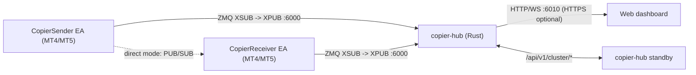

# MT-Copier architecture (current state)

This is the one place that describes how the system is built **today**. The
other documents in `doc/` are either specifications (`PROTOCOL.md`,
`TLS-HTTPS-SPECIFICATION.md`), decision records (`CENTRAL-HUB-HA-FINAL-PLAN.md`
holds the ADRs), operator manuals (`USER_MANUAL.*.md`, `PILOT*.md`) or history
(`HANDOFF.md`, `CENTRAL-HUB-PLAN.md`, `PHASE1-DESIGN.md`,
`CENTRAL-HUB-HA-PLAN.md`, `AUDIT-*-FINDINGS.md`). When a history document and
this one disagree, this one is meant to be right; fix whichever is wrong.

## 1. Components

| Part | Where | Role |
| --- | --- | --- |
| Sender EA | `src/Experts/CopierSender.mq4` | Publishes `SNAP` (full state) plus `OPEN`/`CLOSE`/`MODIFY` events and heartbeats. |
| Receiver EA | `src/Experts/CopierReceiver.mq4` + `src/Include/Copier/Recv*.mqh` | Converges the local book to each sender's snapshot, under its own risk limits. |
| Shared MQL library | `src/Include/Copier/Copier*.mqh` | Wire codec, state files, sizing, symbol mapping, transport, logging. |
| Hub | `hub/` | Relays topics, tracks nodes, stores config/command journals, serves REST/WS and the dashboard, runs HA. |
| Tooling | `tools/` | Deploy/compile/selftest scripts and the Python test suites. |

The `.mq4` files are the single source. `tools/deploy.sh` copies them as `.mq5`
for MT5 terminals; the code compiles on both through `#ifdef __MQL5__`.

## 2. Design rules that everything else follows

1. **The snapshot is the source of truth.** Events (`OPEN`, `CLOSE`, `MODIFY`)
   only shorten the path; a lost event is repaired by the next `SNAP`. The
   receiver is *convergent*: it diffs desired vs. local and acts on the
   difference, so it self-heals after restarts, reconnects and missed frames.
2. **The hub is a relay with a control plane, not a trading engine.** It never
   computes positions for a receiver. Data-plane frames pass through; the hub
   only originates `CFG`, `CMD`, `TOPOLOGY`, `RCPT`, `WHO` and `PONG`.
3. **Text protocol, one envelope.** `V=..|T=..|SID=..|SEQ=..|P=k=v;k=v`. See
   `PROTOCOL.md` for every message type.
4. **Single writer (ADR-03).** Only the Primary hub accepts writes. A Standby is
   read-only and does **not** promote itself unless started with
   `--auto-promote`; the default is a manual Promote.
5. **Epoch fencing (ADR-04).** Every promotion raises the epoch; a hub that sees
   a higher epoch steps down.

## 3. Receiver EA layout

`CopierReceiver.mq4` keeps the inputs, globals, config loading, message
routing and the `OnInit`/`OnTimer`/`OnDeinit` dispatch. The large subsystems
are included **at a fixed point in the file**, so the compiled text is the same
as when they were inline. They are not standalone headers.

| Include | Contents |
| --- | --- |
| `RecvExecute.mqh` | Action queue (`PushAction`, compaction, backoff) and `ExecuteQueue`. |
| `RecvReconcile.mqh` | Lot sizing, partial-close trim, SL/TP modify, account position scan, STAT encoders. |
| `RecvRisk.mqh` | `RefreshRisk` and the close-all path. |
| `RecvConverge.mqh` | Sender clock mapping, exposure counting, `ConvergeSender`. |
| `RecvHubCtl.mqh` | Hub control plane: `CFG` apply/ack, `TOPOLOGY`, `CMD`. |

Per tick the receiver drains the socket, routes each frame (`RouteMessage`),
converges dirty senders, then executes the queue. Risk is refreshed before any
open is queued.

## 4. Hub layout

| Module | Responsibility |
| --- | --- |
| `main.rs` | Argument parsing, socket setup, the poll loop (`run_hub`), periodic jobs. |
| `handlers.rs` | One function per control frame: `handle_ping`, `handle_reg` (REG/HBT2), `handle_ack`, `handle_cfgr`, `handle_cfgrpt`, `handle_stat`. |
| `envelope.rs` | The envelope parsers. |
| `registry.rs`, `positions.rs`, `stats.rs` | Who is connected, what senders hold, counters. |
| `config.rs`, `commands.rs` | Append-only journals for config revisions and commands, with retry ladders. |
| `audit.rs` | Append-only audit log with rotation. |
| `alerts.rs`, `notifications.rs` | Alert rules and outbound channels (Telegram, WeCom, DingTalk, webhook). |
| `users.rs` | Users, roles, sessions. |
| `curve.rs` | CurveZMQ keys and the ZAP allow-list. |
| `tls.rs` | Certificates, ACME, HTTPS listener state. |
| `cluster.rs` | HA state machine, journal replication, failback. |
| `api.rs` | Shared state, router, read-only endpoints, WebSocket, dashboard. |
| `api/auth.rs` | Login, nonce, sessions, user management endpoints. |
| `api/commands.rs` | Node config, commands, alerts, notification endpoints. |
| `api/cluster.rs` | `/api/v1/cluster/*` endpoints. |
| `api/tls.rs` | HTTPS listener, ACME challenge, TLS endpoints. |
| `service.rs` | Windows service install/run. |
| `lockx.rs` | Poison-tolerant locking. |

All mutable hub state lives in one `Shared` behind one `Mutex`
(`SharedState`). Handlers take the lock briefly and never hold it across I/O.
Splitting that lock was considered and rejected: contention is not measurable
at the current node counts, and one lock keeps every invariant in one place.

## 5. High availability

Two hubs, Primary and Standby. EAs connect to both; the `SEQ` ring on the
receiver drops duplicates, so data-plane failover needs no coordination. The
control plane is single-writer: the Standby replicates journals, users,
notification channels and CURVE clients from the Primary over
`/api/v1/cluster/sync` and rejects writes with `409`. Promotion is manual by
default (dashboard or `POST /api/v1/cluster/promote`); `--auto-promote` lets a
Standby promote itself after 30 s without peer contact. Failback is a two-phase
handover after a stabilisation period (`--failback-hours`). The ADRs are in
`CENTRAL-HUB-HA-FINAL-PLAN.md`.

## 6. Testing

| Gate | Command |
| --- | --- |
| Hub unit tests | `bash hub/build.sh --test` |
| MQL compile, all terminals | `bash tools/deploy.sh && bash tools/compile.sh` |
| MQL self-test | `tools\selftest_run.bat` |
| Hub integration suites | `bash tools/tests.sh` |

New behaviour should come with a test first: a `CopierSelfTest` scenario for
EA logic, a Rust unit test or a Python suite for the hub.
