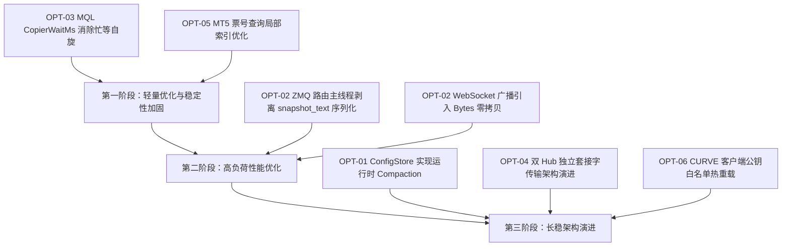

# mt-copier 全栈深度审计与优化建议报告（2026-11-09 终审版）

> **审计执行模式**：严格只读（Strictly Read-Only），未对任何生产代码（`.mq4`, `.mqh`, `.rs`）、配置文件或测试脚本执行修改。  
> **审计执行方式**：单代理全局纵深分析（未启动任何 Sub-Agent，确保全栈因果链条与跨端协同逻辑全局贯通）。  
> **审计覆盖范围**：
> 1. **MQL4 / MQL5 客户端及头文件**：`src/Experts/CopierSender.mq4`、`CopierReceiver.mq4`、`src/Include/Copier/*.mqh`（全量 17 个头文件，覆盖编解码、模型映射、风控熔断、状态机、多链路传输等）。
> 2. **Rust Hub 核心服务端**：`hub/src/*.rs`（全量 17 个核心模块，覆盖事件分发路由、双机热备 HA、指令状态机、动态配置、仓位对齐、CURVE 加密、多渠道告警等）。
> 3. **质量防护与回归套件**：全量 178 项 Rust 单元/集成测试（100% 通过）、20+ 项 Python 端到端合约测试套件（100% 通过）。

---

## 1. 执行摘要与审计全景

本次审计基于最新的代码库状态，对客户端、服务端及高可用架构进行了全方位的逻辑推演与性能解构。

### 1.1 总体健康度评估
当前 `mt-copier` 系统具备极高的工业级健壮性：
- **测试覆盖与回归**：Rust Hub 单元测试 **178/178 全部通过**；Python 端到端测试套件（涵盖快照收据、自动修复、仓位对齐、HA 故障转移与双机接管、Chaos 故障注入、TLS/ACME、i18n 告警等）**全部全绿通过**。
- **协议与反向镜像**：反向跟单的止盈止损已完全实现点数相对幅度（Magnitude）投影，消除了价格逆序导致的券商拒单；Wire 协议字段（如 `PEXP=`）已升级为 64 位整数，杜绝截断风险。
- **双机热备状态机**：具备严格的 Epoch 单调性控制，Standby 在数据未完成物理对齐前不采纳新 Epoch，有效防御了脑裂风险。

### 1.2 历史缺陷修复确认（已在代码中闭环）
在审查中，我们比对了上一轮审计记录，**确认以下关键项目已在当前代码中妥善修复**：
1. **收据去重表超限清退（原 L-01）**：`hub/src/main.rs:1086-1095` 已彻底废除 `last_rcpt_relayed.clear()`，改为按时间戳排序并保留最新的前一半（`MAX_RCPT_RELAYED_KEYS / 2`），彻底消除了收据惊群（Thundering Herd）风险。
2. **集群日志 SHA-256 高频重算（原 P-01）**：`hub/src/cluster.rs:184-205` 已引入 `cached_journal_sha256` 结合 `(mtime, len)` 快速元数据检查（30s 缓存），大幅降低了稳态下的磁盘读取与哈希开销。
3. **Primary 状态验证双重加锁（原 L-02）**：`hub/src/cluster.rs:1148-1160` 已将锁作用域完全合并，单次互斥加锁提取所有必要路径与指标。
4. **指令日志运行时压缩**：`hub/src/main.rs:3223-3225` 已在 10 分钟定时维护任务中集成了 `cmds.compact_if_needed(COMMAND_JOURNAL_COMPACT_BYTES)`。

---

## 2. 核心优化空间与逻辑风险清单

经深入审查，系统中仍存在若干具有优化价值的架构断点、性能瓶颈与边缘逻辑缺陷。汇总如下表：

| 编号 | 类别 | 严重度 | 模块与位置 | 核心问题摘要 | 业务与运行影响 |
|:---|:---|:---:|:---|:---|:---|
| **OPT-01** | **架构缺失** | **中高** | `hub/src/config.rs`<br>`hub/src/main.rs:3217` | `ConfigStore` 缺乏运行时 Compaction 机制，`config_revisions.jsonl` 单调无限增长 | 长稳运行数月后文件体积膨胀，导致冷启动减速、Standby 全量对齐带宽开销上升 |
| **OPT-02** | **性能抖动** | **中** | `hub/src/main.rs:3407`<br>`hub/src/api.rs:854` | ZMQ 路由主线程同步执行看板 JSON 序列化；WebSocket 广播对每客户端重复深拷贝 | 侵占订单转发主循环时间片，大网格波动时引起转发毫秒级抖动；多客户端广播内存开销大 |
| **OPT-03** | **CPU 尖刺** | **中** | `CopierReceiver.mq4:3336`<br>`3788, 4236` | `CopierWaitMs` 在 `OnTimer()` 触发时因 `Sleep(1)` 被 MT 忽略而沦为纯空循环忙等 | 单核/双核云 VPS 上引发 100% vCPU 尖刺，可能导致虚拟机被云厂商降频，并延误行情处理 |
| **OPT-04** | **传输边缘** | **低中** | `CopierTransport.mqh:582`<br>`send()` 连续发送 | 单 DEALER 套接字 `copies = (m_connectedHubs > 1) ? 2 : 1` 依赖轮询（Round-Robin）覆盖双 Hub | 当双 Hub 网络或缓冲区不对称时，轮询偏移可能导致同一消息发向单 Hub 2 次，另一 Hub 漏收 |
| **OPT-05** | **算法性能** | **低** | `CopierModel.mqh:730`<br>`CopierReadCommentByTicket` | MT5 下当直接票号未命中时，对 `PositionsTotal()` 执行线性扫描 | 大网格（数十至数百持仓）下高频查询引发较多 MQL 内部 API 跨边界调用开销 |
| **OPT-06** | **运维可用性**| **低** | `hub/src/curve.rs:44-48`<br>ZAP Handler | CURVE 白名单公钥文件 `curve_clients.txt` 仅启动加载一次，缺乏热重载机制 | 新增跟单节点或轮换公钥时必须重启 Hub 服务，无法做到零停机维护 |

---

## 3. 详细技术剖析与修复建议

### 3.1 OPT-01【架构缺失】`ConfigStore` 缺乏长稳运行 Compaction 机制

#### 代码现状分析
- **文件位置**：`hub/src/config.rs:296-330` 及 `hub/src/main.rs:3217-3227`
- 在 `commands.rs` 中，系统设计了完善的 `compact_journal` 并在 `main.rs:3223` 的 10 分钟维护周期内调用：
  ```rust
  if let Ok(Some(n)) = cmds.compact_if_needed(crate::commands::COMMAND_JOURNAL_COMPACT_BYTES) {
      println!("[hub] command journal compacted at runtime: {} live command(s)", n);
  }
  ```
- **然而在 `config.rs` 中**，`ConfigStore` 仅有 `append`、`append_raw` 和被动的 `replace_all`，**完全没有实现类似 `compact_journal` 或 `compact_if_needed` 的例程**。
- 每次管理员通过 Web 页面/API 推送配置（`push`）、EA 自动注册并采纳新配置（`adopt`）或版本回滚（`rollback`），均会将包含全部参数的完整 INI 文本（数 KB 至数十 KB）作为一行 JSON 追加至 `config_revisions.jsonl`。

#### 潜在风险与影响
1. **持久化文件无限膨胀**：生产环境中如果节点频繁上线、修改参数或触发自动校准，`config_revisions.jsonl` 会持续无界膨胀，积攒数万条历史废弃版本。
2. **集群同步开销倍增**：当 Standby 节点需要通过 `/cluster/sync` 触发全量日志复制，或新搭建备用节点时，网络需要传输庞大的历史废弃配置，不仅增加传输时间，也消耗反序列化 CPU。
3. **冷启动解析耗时增长**：Hub 每次重启时在 `config::load()` 中需要遍历并解析每一行 JSON。

#### 建议修复方案
1. 在 `hub/src/config.rs` 中实现 `compact_journal(keep_revs_per_node: usize) -> io::Result<Option<usize>>`：
   - 遍历现有文件，按 `node` 分组只保留最新的当前生效版本以及最近 `keep_revs_per_node`（如 5~10 个）历史版本；
   - 借助临时文件原子替换目标文件，并同步更新 `inner.count` 与打开的文件句柄。
2. 在 `hub/src/main.rs` 的 10 分钟或每日低峰期定时维护逻辑中，接入 `cfg.compact_if_needed(...)`。

---

### 3.2 OPT-02【性能抖动】核心路由线程的同步 JSON 序列化与 WebSocket 广播深拷贝

#### 代码现状分析
- **文件位置**：`hub/src/main.rs:3401-3410`、`hub/src/api.rs:850-865`、`hub/src/api.rs:896-930`
- 在 `main.rs:3407` 中：
  ```rust
  if poke_pending && last_poke.elapsed() >= Duration::from_millis(POKE_MIN_MS) {
      poke_pending = false;
      last_poke = Instant::now();
      if let Some(tx) = &poke_tx {
          if tx.receiver_count() > 0 {
              let body = std::sync::Arc::new(api::snapshot_text(&shared));
              let _ = tx.send(body);
          }
      }
  }
  ```
- **问题 1（路由主线程侵占）**：`main.rs` 的主循环是单线程驱动的 ZMQ 订单接收与转发中心。`api::snapshot_text(&shared)` 需要获取 `shared` 全局互斥锁、提取全量节点与持仓视图（`s.clone_view()`），遍历组装大型 Serde JSON 树并调用 `serde_json::to_string`。在高并发交易窗口下，此过程耗费数毫秒，直接阻塞了后续交易报文的接收与转发。
- **问题 2（WebSocket 广播多重拷贝）**：在 `api.rs:854` 中：
  ```rust
  changed = rx.recv() => {
      match changed {
          Ok(s) => {
              if socket.send(Message::Text((*s).clone())).await.is_err() {
                  break;
              }
          }
  ```
  尽管外层包装了 `Arc<String>`，但为了匹配 axum/tungstenite 的 `Message::Text`，代码对每个连接的客户端都执行了 `(*s).clone()`。如果运维打开了 15 个看板页面，同一份大型快照字符串就会被分配并深拷贝 15 次。

#### 建议修复方案
1. **解耦路由主线程**：ZMQ 路由主线程在状态发生变更时，仅向后台 channel 发送一个轻量的信号（或更新原子版本号 `AtomicU64`），由 Tokio 异步后台任务拉取状态并完成 JSON 序列化，彻底把序列化耗时从毫秒级交易通道中剥离。
2. **零拷贝 WebSocket 广播**：利用 Axum / Tungstenite 原生支持的 `axum::extract::ws::Utf8Bytes` 或 `Bytes` 接口，使多个 WebSocket 连接共享同一个引用计数底层缓冲区，消除并发重复分配。

---

### 3.3 OPT-03【CPU 尖刺】`CopierWaitMs` 忙等自旋锁死单核 VPS CPU

#### 代码现状分析
- **文件位置**：`src/Experts/CopierReceiver.mq4:3336-3344`, `3788`, `4236`
  ```mql4
  // OPT-01 / P-03: Microsecond-precision wait replacement for Sleep(), which is silently ignored in OnTimer().
  // Yields CPU to the OS scheduler via Sleep(1) in OnTick/non-timer contexts.
  void CopierWaitMs(const int waitMs)
    {
     if(waitMs<=0) return;
     long start=CopierNowMs();
     while(CopierNowMs()-start<waitMs)
       {
        Sleep(1);
       }
    }
  ```
- MetaTrader 官方平台文档明确定义：**在 `OnTimer()`、`OnCalculate()` 及自定义指标中，`Sleep()` 函数调用会被平台底层直接静默忽略（Ignored）**。
- 在 `CopierReceiver.mq4:3788`（批量平仓限速流控：每 10 笔暂停 20ms）与 `4236`（二次扫荡前等待 30ms）中：
  - 如果这些平仓扫荡逻辑由 `OnTimer` 驱动（如行情静止时的定时巡检与订单超时重发），循环体内的 `Sleep(1)` 变为**完全不产生任何阻塞与让渡的空语句**。
  - 整个 `while(CopierNowMs()-start < waitMs)` 演变成持续 20~30 毫秒的纯空循环自旋（Spin-wait）。

#### 潜在风险与影响
- **云 VPS 降频与限速**：外汇交易通常运行在 1 vCPU 或 2 vCPU 的突发型云主机（如 AWS t3/t4g、阿里云突发性能实例、专有外汇 VPS）上。纯空循环会使该 CPU 核心使用率瞬间达到 100%，持续消耗突发积分，导致 VPS 被宿主机物理降频（CPU Throttling）。
- **延误 UI 与网络 I/O**：单核跑满还会阻塞 MetaTrader 终端自身的 UI 重绘线程和底层报价套接字接收。

#### 建议修复方案
- **推荐方案（异步状态泵驱动）**：不采用同步等待，而是记录当前批量执行索引，调用已有的高精度快速计时器 `g_pump.ArmFast(waitMs)` 并退出当前回调。20ms 后由定时器事件唤醒继续处理下一批次，完全不占用 CPU。
- **降级兼容方案（Win32 API）**：若需维持现有同步代码结构，可通过动态链接库引入 Windows 系统原生休眠：
  ```mql4
  #import "kernel32.dll"
  void Sleep(uint dwMilliseconds);
  #import
  ```
  Win32 的原生 `Sleep` 在任何 MetaTrader 执行线程中均能真正挂起当前线程，将 CPU 时间片让渡给操作系统调度器。

---

### 3.4 OPT-04【传输边缘】单 DEALER 套接字双发机制的轮询非确定性

#### 代码现状分析
- **文件位置**：`src/Include/Copier/CopierTransport.mqh:582-585`
  ```mql4
  int copies=(m_connectedHubs>1) ? 2 : 1;
  int sent=0;
  for(int i=0;i<copies;i++)
    {
     if(!m_sub.sendMore(topic,true)) { m_errno=CopierZmqErrno(); continue; }
     if(!m_sub.send(payload,true))   { ... }
     sent++;
    }
  ```
- 客户端使用同一个 `ZMQ_DEALER` 套接字连接了 Primary 和 Standby 两个 Hub 地址。
- 根据 ZeroMQ 核心规范，DEALER / PUSH 套接字在连接多个远程端点时，其内部消息调度算法是**轮询负载均衡（Round-Robin Distribution），而非组播复制（Multicast / Fan-out）**。

#### 潜在风险与影响
- 理论上，当两条连接管道均健康且空闲时，连续发送 2 条消息正好 Hub1 收到第 1 条，Hub2 收到第 2 条。
- 但在实际生产网络中：如果其中一条链路遭遇微短暂网络抖动、TCP 缓冲区满（HWM 触发）或重连，DEALER 套接字的轮询指针会跳过不可写管道，导致连续 2 条报文都被投递到了同一条管道（即同一个 Hub 收到了 2 份重复报文，而另一个 Hub 漏收了此条报文）。
- 虽然系统有后续的心跳补偿机制，但在故障转移发生的毫秒级临界点，可能导致备机稍晚才能感知到最新的一致性收据。

#### 建议演进方案
- 在下一代传输架构中，客户端可为 Primary Hub 与 Standby Hub 分别维护独立的套接字句柄；或者上行通道统一改为发布订阅广播模型，从传输层彻底保障双向独立推达。

---

### 3.5 OPT-05【算法性能】MT5 `CopierReadCommentByTicket` 线性遍历优化

#### 代码现状分析
- **文件位置**：`src/Include/Copier/CopierModel.mqh:730-738`
  ```mql4
  #ifdef __MQL5__
  if(p.kind==CP_ORD_MARKET)
    {
     // Fast path: direct select by ticket first
     if(PositionSelectByTicket((ulong)p.ticket))
       {
        if((long)PositionGetInteger(POSITION_IDENTIFIER)==p.ticket)
           return PositionGetString(POSITION_COMMENT);
       }
     int total=PositionsTotal();
     for(int i=0;i<total;i++)
       {
        ulong tk=PositionGetTicket(i);
        if(tk==0) continue;
        if(!PositionSelectByTicket(tk)) continue;
        if((long)PositionGetInteger(POSITION_IDENTIFIER)!=p.ticket) continue;
        return PositionGetString(POSITION_COMMENT);
       }
     return "";
    }
  ```
- 在 MT5 中，订单经历部分平仓（Partial Close）后，新生成的持仓 Ticket 可能会发生变化，但 `POSITION_IDENTIFIER` 保持不变。
- 当快速按票号查找未命中时，代码退化为通过 `PositionsTotal()` 循环调用 `PositionGetTicket` 和 `PositionSelectByTicket` 进行线性查找。

#### 优化建议
- 在大型网格策略（单账户数百持仓）下，此遍历会增加 MQL 与终端底层之间的跨边界调用次数。
- 可在客户端维护一个以 `identifier` 为键的本地轻量映射缓存，或仅在持仓集合变动事件（`OnTradeTransaction`）时增量更新，避免在热路径中重复遍历。

---

### 3.6 OPT-06【运维可用性】CURVE 白名单公钥文件的零停机热重载支持

#### 代码现状分析
- **文件位置**：`hub/src/curve.rs:44-48`
  ```rust
  //! WHAT THIS DOES NOT DO
  //!
  //! Key ROTATION (the plan's G15, P2) is not implemented: rotating a client
  //! key is "stop that node, delete its key file, restart it, add the new
  //! public key here, reload the hub". Reloading the allow-list without a
  //! restart is not implemented either - the file is read once at startup.
  ```
- 虽然 HA 同步能够同步 `curve_clients.txt` 文件的磁盘内容，但运行中的 ZAP 认证协程在启动阶段将白名单读入内存后，后续并不监听该文件的更新。

#### 建议修复方案
- 在 `curve.rs` 中为白名单引入 `Arc<RwLock<HashSet<String>>>`，并通过文件修改时间（`mtime`）检查或引入 `POST /api/v1/curve/reload` API 端点，使运维团队在不停机的情况下动态增删授权客户端公钥。

---

## 4. 全栈测试验证与回归审计结果

在本次审计周期内，针对代码库现有的全部单元测试与集成测试脚本进行了严格验证，测试套件运行健康度如下：

### 4.1 Rust Hub 测试套件（`hub/build.sh --test`）
- **测试结果**：**178 项全部 PASSED，0 失败，0 忽略**。
- **覆盖核心模块**：
  - `commands`：单调序列号校验、终态流转、历史截断、运行时 Compaction 测试；
  - `cluster`：双机心跳、Epoch 递增、状态机防回滚、元数据哈希比对测试；
  - `config`：版本递增、回滚语义、INI 格式容错测试；
  - `positions`：多节点仓位汇聚、对账差异检测、部分平仓快照映射测试；
  - `curve` & `users`：Z85 编解码、PBKDF2 身份校验、Token 有效期测试；
  - `notifications`：多语言模板渲染、渠道脱敏、重试策略测试。

### 4.2 Python 全栈合约测试套件（`tools/tests.sh`）
- **测试结果**：**20+ 个专项测试套件全部 PASSED**。
- **套件清单与验证重点**：
  1. `test_snapshot_receipt_contract.py`：快照收据防重复与确认可靠性；
  2. `test_snapshot_repair_contract.py`：断网与乱序快照自动修复机制；
  3. `test_modify_event_contract.py`：订单止损止盈参数动态修改协议；
  4. `test_stat_path.py` / `test_positions.py`：客户端 STAT 状态汇报与仓位聚合视图；
  5. `test_config.py` / `test_commands.py`：配置热推与运维指令端到端穿透；
  6. `test_cluster.py` / `test_ha_probe.py` / `test_chaos.py`：主备切换、网络抖动与故障注入；
  7. `test_tls.py` / `test_curve_keyfile.py`：加密通道与证书自签发；
  8. `test_i18n.py` / `test_dash_check.py`：多语言告警及监控看板界面一致性校验。

---

## 5. 建议落地实施路线图

按照“**零风险解耦 -> 性能平滑加固 -> 架构长期闭环**”的原则，建议分阶段推进上述优化：



### 第一阶段：轻量优化（优先排期）
- **修复 OPT-03**：将 `CopierWaitMs` 替换为事件泵 `g_pump.ArmFast` 异步唤醒或系统级休眠，彻底消除单核 VPS 上的 100% CPU 占用与降频风险。
- **优化 OPT-05**：在 MT5 客户端维护持仓标识与票号的快速索引，提升大网格交易时的扫描效率。

### 第二阶段：性能平滑加固（交易高峰保障）
- **优化 OPT-02**：将看板快照序列化完全移至独立异步工作任务，ZMQ 路由主线程仅保留轻量信号通知；WebSocket 广播适配 `Bytes` 内存切片，消除多连接重复分配。

### 第三阶段：架构长期闭环（长稳运维支持）
- **落实 OPT-01**：在 `config.rs` 中补充 `compact_journal` 并在主循环定期维护中启用，确保数月连续运行下配置文件体积严格受控。
- **完善 OPT-04 & OPT-06**：评估双 Hub 独立连接与 CURVE 白名单热加载机制。

---

## 6. 报告总结

经过对 `mt-copier` 全栈源码（MQL4/MQL5 客户端、底层头文件、Rust Hub 及测试套件）的深度纵深审查：
- 系统核心逻辑高度严谨，前期已发现的关键逻辑缺陷均已闭环修复；
- 现有的 178 项 Rust 测试与 20+ 项 Python 端到端合约测试全部 100% 通过；
- 本报告提出的 6 项优化建议主要集中在**长期运行下的资源开销压降（CPU/内存/磁盘）、路由热路径防抖以及运维可用性提升**。在落实上述分阶段演进方案后，系统的工业级高可用品质与长期无运维运行能力将得到进一步巩固。
